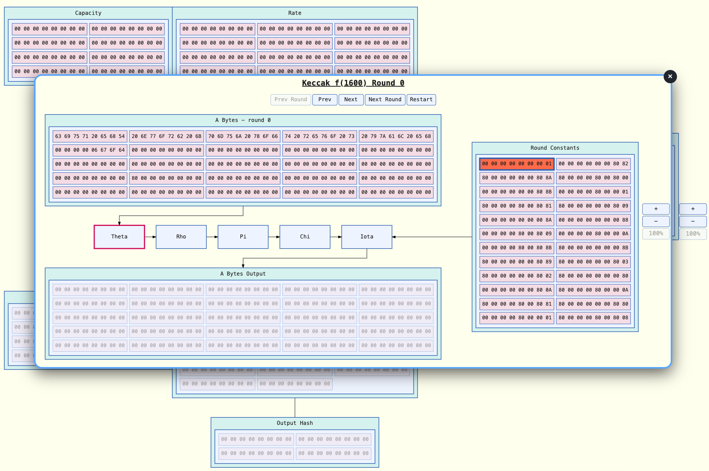

# svg-dom-graph

[](https://github.com/ChrisWhealy/svg-dom-graph/actions) [](https://crates.io/crates/svg-dom-graph) [](https://docs.rs/svg-dom-graph) [](https://github.com/ChrisWhealy/svg-dom-graph)

Draws graphs with dynamically re-routable connectors between SVG boxes.
Each connector routes as a straight line or an elbow, with a configurable corner radius.



Built using [`svg-dom`](https://github.com/ChrisWhealy/svg-dom).

`svg-dom-graph` is a library and holds no opinion about which HTML page hosts it or what sort of graph a caller builds.
See [`library/README.md`](docs/library/README.md) for more details.

_**IMPORTANT**_<br>In keeping with the `svg-dom` crate, this crate also targets WebAssembly only.

The goal is to allow the users to create a scene containing SVG elements suitable for visualising the data flow through an algorithm.
The original target algorithms were SHA1, SHA2 and SHA3; but since implementing these, the number and type of algorithm being visualised has expanded significantly.

<details>
<summary>Cryptographic Algorithms</summary>
<p>&nbsp;&nbsp;&nbsp;&nbsp;SHA1<br>
    &nbsp;&nbsp;&nbsp;&nbsp;SHA2<br> &nbsp;&nbsp;&nbsp;&nbsp;SHA3<br> &nbsp;&nbsp;&nbsp;&nbsp;ChaCha20
</p>
</details>

<details>
<summary>Encoding and Compression</summary>
<p>&nbsp;&nbsp;&nbsp;&nbsp;Huffman Encoding<br>
    &nbsp;&nbsp;&nbsp;&nbsp;Base64 Encoding<br> &nbsp;&nbsp;&nbsp;&nbsp;UTF-8 Encoding
</p>
</details>

<details>
<summary>Error Detection and Correction</summary>
<p>&nbsp;&nbsp;&nbsp;&nbsp;CRC-32<br>
    &nbsp;&nbsp;&nbsp;&nbsp;Hamming(7,4)<br> &nbsp;&nbsp;&nbsp;&nbsp;QR Code
</p>
</details>

<details>
<summary>Sorting</summary>
<p>&nbsp;&nbsp;&nbsp;&nbsp;Bubble Sort<br>
    &nbsp;&nbsp;&nbsp;&nbsp;Shell Sort<br> &nbsp;&nbsp;&nbsp;&nbsp;Quicksort
</p>
</details>

<details>
<summary>Graph Algorithms</summary>
<p>&nbsp;&nbsp;&nbsp;&nbsp;Dijkstra's Shortest Paths<br>
    &nbsp;&nbsp;&nbsp;&nbsp;Weighted Springs<br> &nbsp;&nbsp;&nbsp;&nbsp;Edmonds-Karp Maximum Flow<br> &nbsp;&nbsp;&nbsp;&nbsp;Red-Black Tree<br> &nbsp;&nbsp;&nbsp;&nbsp;Tarjan's Strongly Connected Components
</p>
</details>

<details>
<summary>Signal Processing</summary>
<p>&nbsp;&nbsp;&nbsp;&nbsp;Sine and Cosine<br>
    &nbsp;&nbsp;&nbsp;&nbsp;Pythagoras<br> &nbsp;&nbsp;&nbsp;&nbsp;Amplitude and Frequency<br> &nbsp;&nbsp;&nbsp;&nbsp;Phase Shift<br> &nbsp;&nbsp;&nbsp;&nbsp;Convolution<br> &nbsp;&nbsp;&nbsp;&nbsp;Fast Fourier Transform
</p>
</details>

<details>
<summary>Cellular Automata</summary>
<p>&nbsp;&nbsp;&nbsp;&nbsp;Conway's Game of Life</p>
</details>

<details>
<summary>Backtracking</summary>
<p>&nbsp;&nbsp;&nbsp;&nbsp;N-Queens Problem</p>
</details>

<details>
<summary>Computational Geometry</summary>
<p>&nbsp;&nbsp;&nbsp;&nbsp;Marching Squares</p>
</details>

<details>
<summary>Concurrency</summary>
<p>&nbsp;&nbsp;&nbsp;&nbsp;Petri Net: Bounded Buffer<br>
    &nbsp;&nbsp;&nbsp;&nbsp;Service Simulator: Queue and Servers
</p>
</details>

<details>
<summary>Scale</summary>
<p>&nbsp;&nbsp;&nbsp;&nbsp;Sparse Matrix: Scale and Limits</p>
</details>

## [Changelog](changelog.md)

A list of the significant commits making up each release.

## Documentation

| File                                               | Description                                                                                                                                                                                                                                                                |
| -------------------------------------------------- | -------------------------------------------------------------------------------------------------------------------------------------------------------------------------------------------------------------------------------------------------------------------------- |
| [`docs/library/README.md`](docs/library/README.md) | The crate's own module layout, and `Scene`'s public API grouped by area.                                                                                                                                                                                                   |
| [`docs/demo/README.md`](docs/demo/README.md)       | What the demo shows, how the demo server works and how `demo-app`/`demo-server` are put together.                                                                                                                                                                          |
| [`docs/testing/README.md`](docs/testing/README.md) | The test suite: native unit tests, browser integration tests, the CDP tests, and the checks of the harnesses and simulator.                                                                                                                                                |
| [`docs/security.md`](docs/security.md)             | Resource limits to impose when building a graph from untrusted input.                                                                                                                                                                                                      |
| [`perf/README.md`](perf/README.md)                 | The performance harness: its workloads, runners, baselines and how to compare a change with them.                                                                                                                                                                          |
| [`spmv/README.md`](spmv/README.md)                 | The sparse-matrix scale demonstrator and its independent JavaScript oracle.                                                                                                                                                                                                |
| `dess/`                                            | The discrete-event service simulator behind the Service Simulator demo. Each stage (`s0` to `s5`) and each phase of the gallery panel (`demo-panel/p0` to `p4`) has its own `README.md`, and `node dess/gather-evidence.mjs` runs every check that gathers their evidence. |
| `design-specs/`                                    | The design specifications, as PDFs, that the larger demos and the simulator were built from.                                                                                                                                                                               |

## Live Demo

A live demo is [available here](https://whealy.com/Rust/svg-dom-graph/index.html)

## Running the Demo Locally

The demo is a non-published workspace crate that serves as a standalone demo app.
Clone this repo to your local machine, then run:

```sh
cargo demo
```

The demo is built and then served at <http://127.0.0.1:8000/>.
Set the `PORT` environment variable to use another port, for example `PORT=9000 cargo demo`.
The coding used to create each demo is shown beneath each example.

## Testing

The tests are in several layers, and [`docs/testing/README.md`](docs/testing/README.md) lists every command.

| Layer                                                                       | Run with                                                                            |
| --------------------------------------------------------------------------- | ----------------------------------------------------------------------------------- |
| Native unit tests                                                           | `cargo test`                                                                        |
| Browser integration tests, in `tests/drag/`                                 | `wasm-pack test --headless --chrome` or `--firefox`                                 |
| Real input and the accessibility tree, through the Chrome DevTools Protocol | `cargo cdp-test`                                                                    |
| The demo's own tests                                                        | `cargo test -p svg-dom-graph-demo` and `cargo test -p demo-server`                  |
| The performance harness and the service simulator                           | See [`perf/README.md`](perf/README.md) and the `README.md` of each stage in `dess/` |

## Error Handling During Testing

All tests in this crate follow the convention that they return `Result<(), String>` rather than simply panicking if an assertion fails.
This makes errors much easier to read by removing the noisy clutter created by reams of stack trace output.
