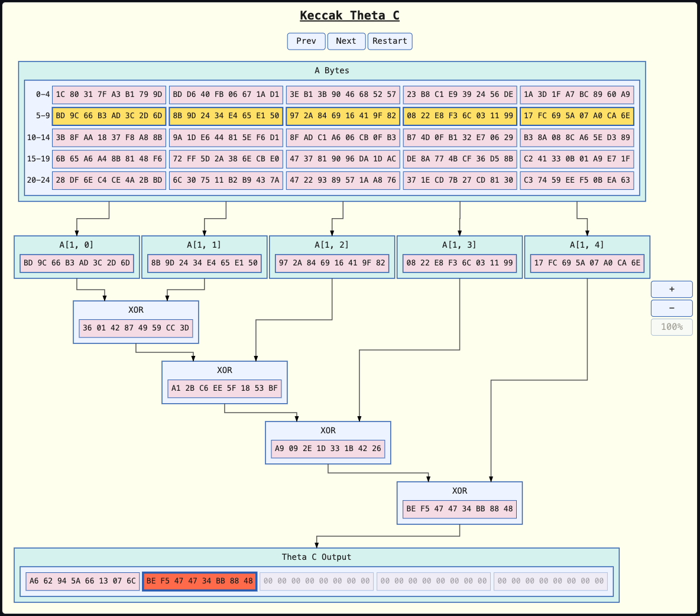

# Cell Selection

Demonstrates `Selection` and `Scene::set_selection` in which a highlight is drawn around either a specific cell, or a whole row/column, of a `DataNodeContent` grid.

This allows there to be a visual representation of stepping through an array's values using "previous" and "next" controls.
Each example is stepped by its own in-canvas selection toolbar, `Scene::show_selection_toolbar`, which holds the buttons Prev, Next and Restart.

## One-Dimensional Array

For a one-dimensional array (a single row or column), `Selection::Cell(i)` is enough.
There is no separate "row" to highlight distinctly from the element within it.


## Two-Dimensional Arrays

Two two-dimensional arrays sit side by side.
The first holds ten values in four columns, so its last row is short.
The second holds three `u32` values in hexadecimal, one to a row, with its rows labelled `a`, `b` and `c` by `LabellingStyle::Alphabetic`.
A label is drawn beside each row, and is quoted in each cell's accessible name as `"element a, row 0, column 0: ..."`.

For a two-dimensional array, `Selection::Row` or `Selection::Column` are used to highlight a whole row or column.
Then within this, a specific cell can be highlighted, in a second, stronger colour.
This two-tier highlight marks "we are now processing this row" and "specifically this element" as two distinct steps of a data-flow walk.

The screenshots show arrays, bothe with and without labelling.


A grid can contain an incomplete last row or column.
`GridLayout::Automatic`, or an over-specified `GridLayout::Rows` or `GridLayout::Columns`, can leave a row or column short of real cells.

Attempting to `set_selection` with a `Selection` that names a non-existent cell, will be rejected before any rendering takes place.

```rust
scene.set_selection(node, Selection::Cell(2))?;
scene.set_selection(node, Selection::Row { row: 1, col: Some(2) })?;
scene.set_selection(node, Selection::None)?; // clears back to the default colour
```

## Selecting Rows Values to Supply Into an Operator Chain

The demo's third example steps an operator chain across an array, rather than just highlighting one.
For each row `n` of the 5×5 input array `A`, SHA-3's own `ThetaC` step computes `C(n)`:

```text
ThetaC(n) = A(n,0) XOR A(n,1) XOR A(n,2) XOR A(n,3) XOR A(n,4)
```

The result is written to output array `O(n)` — five `u64` values folded through four `BinaryOperator::Xor` nodes.



The chain's operator nodes cannot have their results replaced once drawn, because a caller supplies an operator's result when the node is added.
(`Scene::set_data_values` can replace the values of an ordinary data node, and the hash demos below use it.)
So each step clears and redraws the whole diagram from scratch with the current row's own real values.
`demo-app`'s own `edge_anchors::rebuild_edge_anchors_scene` already takes the same approach, for a different reason — a fixing-point count with a different child spread.

`A` and `O` each keep their own real shape — `A` is `[5; [5; u64]]`, `O` is `[5; u64]` — rather than folding into one shared grid.
The stepping toolbar is at the top of the diagram.
The rows of `A` are labelled `0-4`, `5-9` and so on with `LabellingStyle::Text`.
So each row shows the range of flat positions it holds.
`A` sits at the top of the canvas, above the chain it feeds; `O` sits directly below the chain's own final `XOR` node.
`A`'s own row `n` is banded, and `O`'s own cell `n` is focused, via the same `Scene::set_selection` each step reapplies to both.
A connector only ever lands on a node's own outer edge, never a specific cell inside it — `svg-dom-graph` connects whole nodes, not cells.
Putting `O` right after the chain, with nothing else in between, lets a plain edge from the chain's own final `XOR` node reach `O` directly.
The edge then reads as "into the output."
That final `XOR` node's own position is fixed, rather than tracking `n`.
It is the same position the node would occupy for `n == 3`.
Nothing sits between it and `O`, regardless of which row is current.
So there was never a correctness reason for it to move.

This example keeps its current `Scene` alive, replacing it on each step.
The toolbar's buttons hold only a weak reference to their scene, so a scene dropped at the end of the step would leave them dead.
Each step draws a new `Scene`, so zoom and pan return to their starting position whenever "Previous" or "Next" is pressed.

`n` is clamped to `0..=4`, not wrapped like the first two examples.
Stepping "Previous" also resets the row being left — not the row arrived at — back to `O`'s own initial (all-zero) value.
So a walked-past output only ever reads as valid because the forward walk itself produced it.

## Selection State and Assistive Technologies

For assistive technologies, the selection state cannot be conveyed simply by using the text or background colour.

The focused row is outlined using a slightly thicker stroke, within which, the highlighted cell again has a slightly thicker stroke.
The node's own `aria-label` is rebuilt on every call to describe the current selection as text, e.g. `"u8 data grid, 2 rows by 3 columns, 6 values, row 1 selected, column 2 focused"`.
