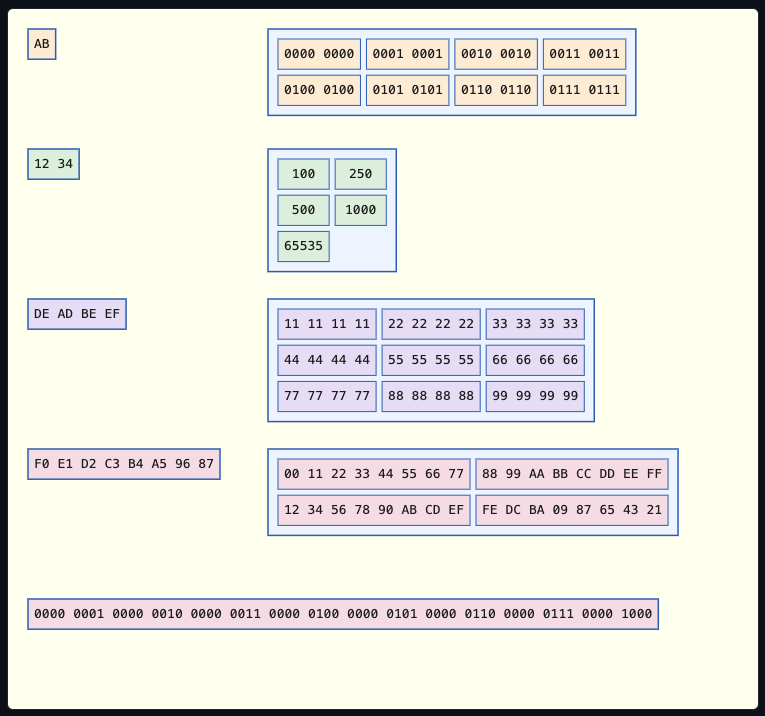

# Data Node

Demonstrates the idea that rather than simply having a text label, a node can have a specific type of `DataNodeContent`.

At the moment, the data types are limited to `u8`/`u16`/`u32`/`u64`.
They can be formatted as decimal, hexadecimal, or binary, and `u8` values that are text can also be drawn as `DataFormat::Ascii`, one character to a cell, or as `DataFormat::PlainText`, one box holding the whole string.

If `DataNodeContent` is an array, the data will be presented in the form of a grid having a particular type of `GridLayout`.

The default layout (`GridLayout::Automatic`), tries to arrange the data using a power-of-two row count over a plain square shape.
This layout matches the row/column groupings common in memory dumps and register views.
So, eight values become two rows of four, not a 3×3 square with an empty slot and twenty values become four rows of five.

When no power-of-two row count divides the array size evenly, the grid falls back to the closest-to-square shape.
So, a single value is simply displayed as-is; two values stack as a single column containing two rows and twenty-five values form a 5×5 square.

`GridLayout::Automatic` sizes a grid by cell *count*, not physical width.

A handful of very long values, such as a `u64` under `DataFormat::Binary`, can still render as a square (based on cell count).
Even so, the rendered width will be far wider than its height.

`GridLayout::Columns`, `Rows`, and `MaxColumns` let a caller override the shape directly.
`MaxColumns` caps how wide such a grid can get, regardless of value count.

Nodes in this panel are draggable and have built-in connector routing and drag-collision handling.

***Displaying Binary or Hexadecimal Values*** 
Displaying successive byte-groups as a long string would make the end of one string and the start of the next indistinguishable.
Therefore, each value is displayed in a separate box, coloured according to its own type — `u8`, `u16`, `u32`, or `u64`.

As far as assistive technology is concerned, colour alone does not convey any useful information.
Therefore, the node's type name is attached both as an SVG `<title>` (shown as a browser tooltip) and as an `aria-label`.

A multi-value grid's own `aria-label` spells out its row/column shape too, not just its flat value count — e.g. `"u8 data grid, 2 rows by 3 columns, 6 values"`.
Each individual cell also carries its own `aria-label`, naming its row and column directly — e.g. `"row 1, column 2: 6"`.
That relationship is no longer left implicit in the cell's own on-screen position.

Binary and hexadecimal values are displayed in their natural byte order, with the most-significant-byte first (`ByteOrder::BigEndian`).

Bytes are space-separated, without a `0x` prefix: for example, a `u64` value might be displayed as `F0 E1 D2 C3 B4 A5 96 87` in hexadecimal.

Binary format further splits each byte into its own upper and lower nybble, so `0xF0` would be displayed as `1111 0000`.

This can be reversed by setting `DataNodeContent::with_byte_order(ByteOrder::LittleEndian)`.
This will visualise the actual in-memory byte layout, rather than the network byte order.
