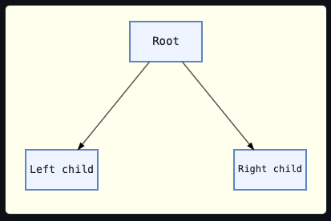

# Directed Tree

Shows a directed tree of three boxes (one root, two children), connected by straight, arrow-tipped connectors attached at each node's centre.

The two child boxes are draggable.
Dragging one redraws its connector on every pointer-move, so it stays attached to the root.
