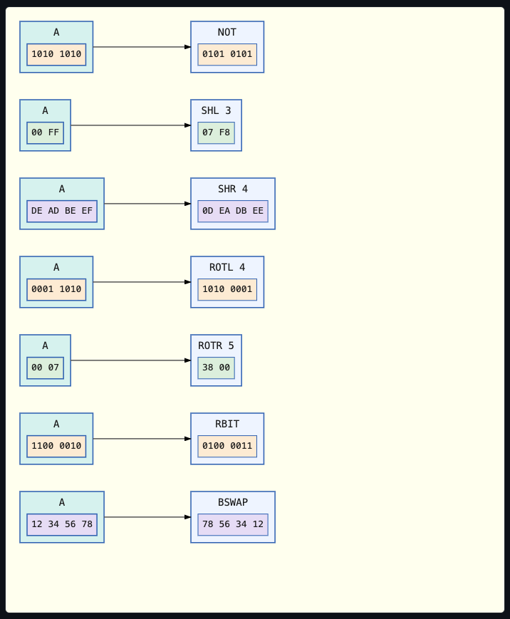
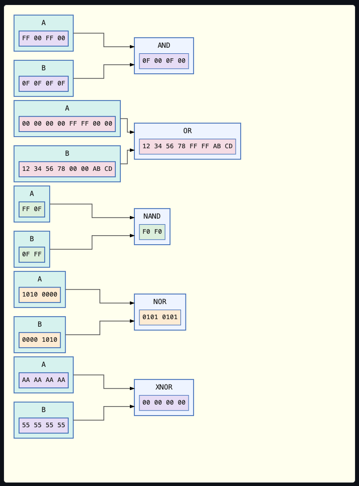
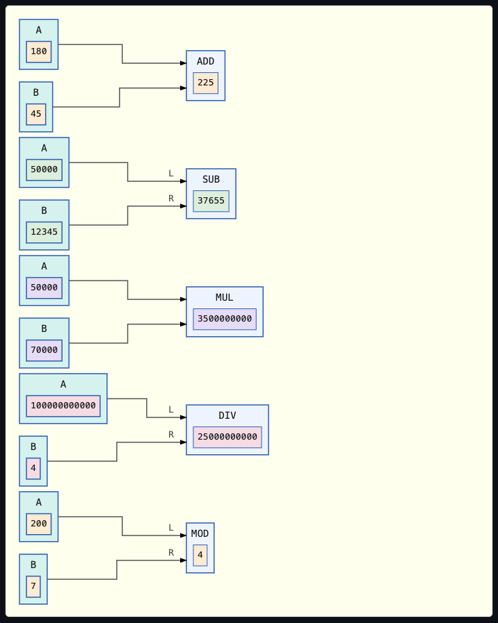
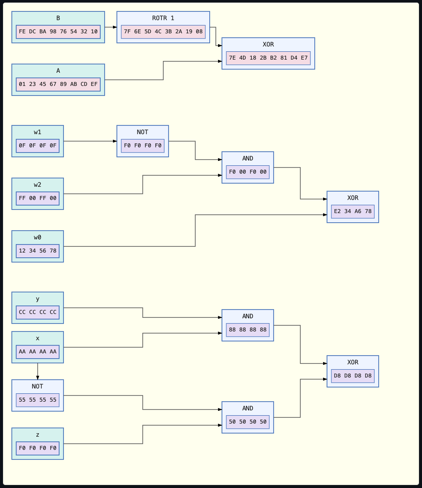

# Operator Nodes

Building on `DataNodeContent`, an operator node displays the operator name in the outer node and a user-supplied value in the inner node.

***IMPORTANT***<br>
It is important to understand that operator nodes exist only for the purpose of visualisation, not calculation!
You must calculate the correct value yourself!

Every operator panel, and the "operator chain over an array" example under [Cell Selection](cell-selection.md), shows the toolbar along its east edge.
Its "+", "−", and "100%" buttons zoom the diagram, dragging the background pans it, and Ctrl or Cmd plus the mouse wheel zooms about the pointer.
See `Scene::show_toolbar`.

Each oif the functions `Scene::add_unary_operator_node`, `add_binary_operator_node`, and `add_arithmetic_operator_node` draws a labelled node and auto-wires it to its operand(s), so the rendered graph can never drift from the relationship it claims to visualise.

## Unary Operators



The standard bitwise unary operators can be represented by `Scene::add_unary_operator_node`.
These are:
* `NOT` Bitwise complement
* `SHL` Arithmetic shift left
* `SHR` Arithmetic shift right
* `ROTL` Rotate left
* `ROTR` Rotate right
* `RBIT` Reverse bit order
* `BSWAP` Swap byte order

## Binary Operators



The standard bitwise binary operators can be represented by `Scene::add_binary_operator_node`.
These are:
* `AND` Logical conjunction
* `OR` Logical disjunction
* `XOR` Logical exclusive disjunction
* `NAND` Negation of logical conjunction
* `NOR` Negation of logical disjunction
* `XNOR` Negation of logical exclusive disjunction

Every operand in this demo is a named data node (`Scene::add_named_data_node`), e.g. `"A"`/`"B"`, not a bare, unnamed value.
Auto-wiring each operand's edge also extends both its own `aria-label` and the operator's own `aria-label` with an "Output to"/"Input from" clause naming the other.
So which value feeds which operator is never conveyed by the connector's `<path>` alone.

A unary operator node takes a single operand and draws a connector on its incoming edge:

## Arithmetic Operators



A basic set of arithmetic operators can be represented by `Scene::add_arithmetic_operator_node`.
These are:
* `ADD` Addition
* `SUB` Subtraction
* `MUL` Multiplication
* `DIV` Division
* `MOD` Modulus

Each of these nodes takes two input values, identified in the coding as `inputs.0` and `inputs.1`.
Irrespective of whether the operator commutes or not, `inputs.0` is always treated as the left-hand operand, and `inputs.1` as the right-hand one.

For non-commutative operators, the two operand connectors carry small "L" and "R" port markers.
This keeps each operand's identity visible, even after dragging swaps which side the connector renders on.

For commutative operators such as `ADD`, `MUL`, `AND` and `OR` etc, no such markers are drawn.

## Chained Operators

The output of one operator can feed into another operator.
This allows you to visualise the flow of data through an arbitrary sequence of operators.



The functions shown above are the following:
* `B` rotated right by one bit, then `XOR`'ed with `A`
* `XOR(w0, AND(NOT(w1), w2))` for three `u32` values
* SHA-256's own "Choose" function, `Ch(x, y, z) = (x AND y) XOR (NOT(x) AND z)`, whose `x` feeds two separate operator nodes

The coding below shows an example of how you must calculate the correct value displayed within a `NOT` operator node.

```rust
let demo_value = 0b1010_1010u8;
let operand = scene.add_named_data_node(
    Point::new(10.0, 10.0),
    "A",
    DataNodeContent::new(NodeValues::U8(vec![demo_value]), DataFormat::Binary),
)?;
scene.add_unary_operator_node(
    Point::new(200.0, 10.0),
    UnaryOperator::Not,
    operand,
    DataNodeContent::new(
        NodeValues::U8(vec![!demo_value]), // You must calculate the correct value here!
        DataFormat::Binary,
    ),
)?;
```

The binary operator nodes (`AND`, `OR`, `XOR`, `NAND`, `NOR`, `XNOR`) take two operands and draw two incoming connectors the same way, via `Scene::add_binary_operator_node`.
Both operands must share one `NodeValues` width, and must be two distinct nodes; if this is not the case, either will be rejected before anything is drawn.

```rust
let value_a = 0xFF00_FF00u32;
let value_b = 0x0F0F_0F0Fu32;

let operand_a = scene.add_named_data_node(
    Point::new(10.0, 10.0),
    "A",
    DataNodeContent::new(NodeValues::U32(vec![value_a]), DataFormat::Hexadecimal),
)?;
let operand_b = scene.add_named_data_node(
    Point::new(10.0, 100.0),
    "B",
    DataNodeContent::new(NodeValues::U32(vec![value_b]), DataFormat::Hexadecimal),
)?;

scene.add_binary_operator_node(
    Point::new(200.0, 55.0),
    BinaryOperator::And,
    (operand_a, operand_b),
    DataNodeContent::new(
        NodeValues::U32(vec![value_a & value_b]), // You must calculate the correct value here!
        DataFormat::Hexadecimal
    ),
)?;
```

`operand_a` and `operand_b` must each hold the value they are actually declared to hold.
The result passed to `add_binary_operator_node` must be that same operator correctly applied to both of them.

`svg-dom-graph` makes no attempt to check this: it only checks that `operand_a`, `operand_b`, and the result share one `NodeValues` width, not that the result is arithmetically correct.

***IMPORTANT***<br>
Supplying some inncorrect value (instead of the correct `value_a & value_b`) will draw a node whose displayed value is silently wrong!

An operator node's own result is itself a `DataNodeContent`, so it is a valid operand for a further operator node.
